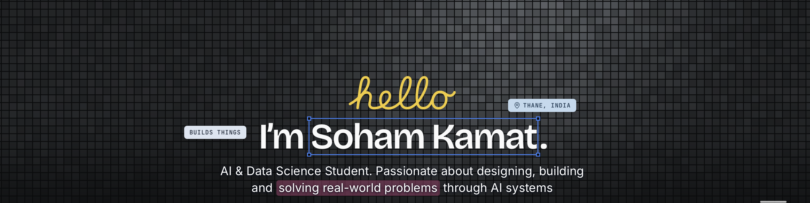

  

  
  
  
  

## Hi, I'm Soham

I am an **AI and Data Science undergraduate** who builds practical AI products: retrieval systems, NLP applications, intelligent APIs, and data-rich web experiences. I care about the full path from a sound model or retrieval pipeline to a product that is reliable, testable, and useful.

- Studying B.Tech Artificial Intelligence and Data Science at K.J. Somaiya School of Engineering with a **9.98/10 CGPA**.
- Building with **Python, FastAPI, RAG, hybrid search, structured LLM outputs, PostgreSQL/pgvector, and Next.js**.
- Previously a **Technical Product Intern at Purple Ribbon Healthcare**, where I defined role-based workflows and designed four healthcare coordination modules.
- Open to internships and collaborations in **applied AI, machine learning, data, and AI product engineering**.

## Selected work

| Project | What I built | Core stack | Links |
| --- | --- | --- | --- |
| **ResumeLens ATS** | AI resume and job-description analysis with robust structured extraction, evidence-aware skill matching, saved analyses, and downloadable reports. | Python, FastAPI, Next.js, Supabase, Groq, spaCy, RapidFuzz | [Code](https://github.com/sohamkamat28/ATS_SCORER) · [Live](https://resumelens-ats.vercel.app/) |
| **Parity** | Version-aware retrieval and contextual chat over monitored web content, combining dense and full-text search with citation checks, history, diffs, and five MCP tools. | Python, FastAPI, PostgreSQL, pgvector, MiniLM, MCP | [Code](https://github.com/sohamkamat28/parity/tree/codex/final-parity) |
| **Eureka** | Research-paper and conference discovery across Crossref, arXiv, and scraped conference sources, with TF-IDF ranking, provenance, bookmarks, caching, and bounded retries. | Python, FastAPI, SQLite, scikit-learn, Beautiful Soup, HTTPX | [Team repository](https://github.com/yajask-maker/Webscrap_proj_Sem5) |
| **AI Gym Coach** | Real-time pose analysis and repetition tracking for five exercises, paired with conversational voice coaching and per-user workout history. | Python, MediaPipe, OpenCV, Streamlit, WebRTC, Groq, SQLite | [Code](https://github.com/sohamkamat28/AI-GYM_COACH) · [Live](https://ai-gym-bot.netlify.app/) |

## Technical toolkit

**Languages**

  
  
  
  
  

**AI, ML, and retrieval**

  
  
  
  
  
  
  
  
  
  
  

**Backend and data**

  
  
  
  
  
  
  
  
  
  

**Product and delivery**

  
  
  
  
  
  
  
  

## Experience and open source

- **Purple Ribbon Healthcare:** translated healthcare operations into product requirements, role-based workflows, and wireframes for four patient and care-coordination modules.
- **Recordly:** merged [PR #1181](https://github.com/webadderallorg/Recordly/pull/1181), removing 12 unused wallpapers and adding a Vitest regression test for legacy-background fallback.
- **Hugging Face Datasets:** submitted [PR #9031](https://github.com/huggingface/datasets/pull/9031) to fix Arrow writing for leading-null nested lists, with regression coverage for mixed-type and JSON-string inputs.

## Current direction

- Building retrieval systems that combine semantic search, full-text search, reranking, provenance, and evaluation.
- Designing AI backends with typed contracts, structured outputs, durable persistence, and useful failure states.
- Turning ML and LLM capabilities into products people can understand, trust, and use.

  <b>Open to applied AI, machine learning, data, and AI product engineering opportunities.</b>

