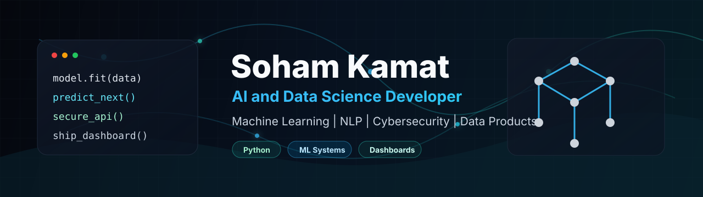

<p align="center">
  
</p>

<p align="center">
  <a href="mailto:kamatsoham28@gmail.com"></a>
  <a href="https://www.linkedin.com/in/sohamkamat28/"></a>
  <a href="https://github.com/sohamkamat28"></a>
</p>

---

## About me

I am a B.Tech Artificial Intelligence and Data Science student at K.J. Somaiya School of Engineering, Mumbai, building AI systems, ML dashboards, healthcare NLP tools, and security-focused prototypes.

- Current focus: applied machine learning, NLP/OCR, explainable decision systems, and AI-assisted cybersecurity.
- Strongest stack: Python, scikit-learn, Pandas, Streamlit, Dash, Flask, FastAPI, React, Next.js, SQL, and data visualization.
- Academic signal: 9.97 CGPA in AI and Data Science, with project work across ML, BI, secure systems, and full-stack products.
- Builder mode: I like turning raw datasets, reports, and system logs into products people can actually use.

---

## Technology I work with

<p align="center">
  
  
  
  
  
  
  
  
  
  
  
  
  
  
  
  
  
  
  
  
  
  
</p>

---

## Featured work

| Project | What it does | Stack |
| --- | --- | --- |
| [MedSimplify](https://github.com/sohamkamat28/medlife) | Simplifies medical reports by extracting text from images, detecting biomedical entities, and mapping terms to patient-friendly definitions. | Python, Dash, Tesseract OCR, Hugging Face, Pandas |
| [StockSense](https://github.com/sohamkamat28/StockSense) | Predicts next-day stock movement with an ID3-style decision tree, technical indicators, backtesting, confidence scoring, and D3 visual explanations. | Flask, scikit-learn, yfinance, D3.js, HTML/CSS/JS |
| [SpotifyDashboard](https://github.com/sohamkamat28/SpotifyDashboard) | Interactive music analytics dashboard for 2,000 Spotify tracks with clustering, PCA, EDA, trends, and genre analysis. | Streamlit, Plotly, Pandas, scikit-learn |
| CreditWise Loan System | Loan approval ML pipeline with EDA, feature engineering, KNN, Logistic Regression, Naive Bayes, and model evaluation. | Python, Pandas, scikit-learn, Jupyter |
| SENTINEL | AI-driven zombie API security platform for banks, with eBPF traffic discovery, risk scoring, pre-zombie prediction, virtual patching, and phased decommissioning. | Python, FastAPI, Isolation Forest, NetworkX, AWS Bedrock |
| Secure Banking MITM Simulation | Demonstrates insecure communication attacks, Diffie-Hellman key exchange, AES-256-CBC encryption, SHA-256 derivation, and socket programming. | Python, Cryptography, Sockets |

---

## Project cards

<p align="center">
  <a href="https://github.com/sohamkamat28/medlife">
    
  </a>
  <a href="https://github.com/sohamkamat28/StockSense">
    
  </a>
</p>

<p align="center">
  <a href="https://github.com/sohamkamat28/SpotifyDashboard">
    
  </a>
  <a href="https://github.com/sohamkamat28/personality-test">
    
  </a>
</p>

---

## AI and data science map

```text
Machine Learning      -> classification, clustering, PCA, backtesting, feature engineering
NLP and OCR           -> biomedical NER, report simplification, glossary lookup, Tesseract
Data Products         -> Streamlit, Dash, Plotly, Power BI, interactive analytics
Security Engineering  -> API risk scoring, MITM simulation, AES-256, Diffie-Hellman, eBPF ideas
Full Stack            -> Flask, FastAPI, React, Next.js, Vite, MongoDB, Supabase
```

---

## GitHub snapshot

<p align="center">
  
  
</p>

<p align="center">
  
</p>

<p align="center">
  
</p>

---

## Currently exploring

- Agentic AI systems that combine retrieval, tool use, reasoning, and human approval.
- Applied NLP for healthcare and education workflows.
- Secure API lifecycle intelligence for banking and enterprise systems.
- Cleaner visual storytelling for ML models, dashboards, and decision paths.

---

<p align="center">
  <b>Open to AI, data science, full-stack, and cybersecurity collaborations.</b>
</p>
